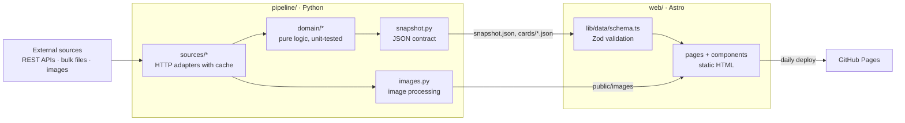

# Deckade

**Which Magic: The Gathering sets are in Standard right now – and when do they rotate out?**

Deckade is a bilingual (German / English) fan website that answers that question with nothing
but public data:

- every Magic set since 1993 on one timeline
- the Standard rotation in detail
- every card with its market price and how often it is played in tournaments
- bundle and booster box prices

## Features

- **All sets** – a timeline by year. Each set opens as an overlay with its own URL: release
  date, card count, product prices and the full card list.
- **All cards** – every card once (cheapest printing, newest image), with search in name and
  rules text, filters for colour, mana value and type, and a large card preview.
- **Standard rotation** – the Standard sets grouped by when they leave, the next rotation as
  the headline. Estimates are labelled as estimates.
- **Search** – a request in plain German or English („günstige rote Kreaturen mit Eile“) becomes
  filters for colour, type, keyword, synergy („Synergie mit Artefakten“), mana value, price
  and order. It runs in the browser
  ([ADR 0002](docs/adr/0002-natural-language-search.md)).
- **German and English** – every page in both languages; German pages show German card names
  and images wherever a German printing exists.
- **Static and fast** – plain HTML without a client framework and self-hosted fonts; JavaScript
  only adds filtering, sorting and the set overlay.

## Technical implementation

The project consists of two parts with a clear contract between them:

| Part                    | Stack                                                    | Responsibility                                                   |
| ----------------------- | -------------------------------------------------------- | ---------------------------------------------------------------- |
| [`pipeline/`](pipeline) | Python 3.12, httpx, Pillow · pytest, mypy (strict), ruff | Fetch and process the data, write a JSON snapshot and the images |
| [`web/`](web)           | Astro 7, TypeScript (strict), Zod · Vitest, Prettier     | Validate the snapshot and render a static, SEO-friendly website  |

### Architecture



- **Everything happens at build time.** The pipeline collects and processes the data once per
  build; the deployed site is plain static files, without a server or a database.
- **Domain logic is pure.** `pipeline/src/rotation_radar/domain` has no network or file access;
  adapters in `sources/` translate raw responses into domain objects.
- **One data contract.** The pipeline writes camelCase JSON (`snapshot.py`, `SCHEMA_VERSION`);
  the website validates it with Zod at build time (`web/src/lib/data/schema.ts`) and fails the
  build instead of shipping a broken page.
- **Wording is logic, too.** `web/src/lib/rotation/describe.ts` turns rotation data into text
  for both languages and is tested with the real dictionaries.

### Project structure

```
pipeline/
  rules.toml                 rotation rule parameters, official date, special rules
  src/rotation_radar/
    domain/                  sets, rotation, cards, products, play rate (pure)
    sources/                 HTTP client and one adapter per external source
    images.py                image processing: pack images and mana symbols
    snapshot.py              data contract and JSON writer
    build.py, cli.py         orchestration: python -m rotation_radar build
  tests/
web/
  src/
    config/site.ts           site name, languages
    lib/                     data loading, i18n, formatting, rotation text, sorting
    components/ layouts/ pages/ scripts/ styles/
    data/generated/          snapshot written by the pipeline (not committed)
  public/images/             images written by the pipeline (not committed)
  tests/                     incl. contract/: snapshot files the pipeline tests keep current
docs/adr/                    architecture decisions
.github/workflows/           CI for main and pull requests, daily refresh + deploy
```

## Getting started

Requirements: Python 3.12+, Node.js 22.23+ (Astro 7).

```bash
# Data pipeline
cd pipeline
python -m venv .venv
.venv/Scripts/activate          # Windows; on macOS/Linux: source .venv/bin/activate
pip install -e ".[dev]"
python -m rotation_radar build  # writes web/src/data/generated and web/public/images

# Website
cd ../web
npm ci
npm run dev                     # http://localhost:4321
```

The website needs a snapshot: run the pipeline once before `npm run dev`. The first run
downloads about 480 MB of Scryfall bulk data and the pack images and takes several minutes;
both are cached in `pipeline/.cache` and `web/public/images`, so later runs take about two.
Generated data is not committed: the deployment builds it fresh every day.
Set `GITHUB_TOKEN` to raise the GitHub API rate limit for the decklist download.

## Quality checks

| Pipeline                | Website          |
| ----------------------- | ---------------- |
| `pytest`                | `npm test`       |
| `mypy` (strict)         | `npm run check`  |
| `ruff check src tests`  | `npm run lint`   |
| `ruff format src tests` | `npm run format` |

All of them run in [CI](.github/workflows/ci.yml) on every push to `main` and on every pull
request. CI does not download live data: the website is checked against the small snapshot in
`web/tests/contract`, which the pipeline's contract test keeps in sync with what the pipeline
writes. After an intended change of the data contract, run
`UPDATE_CONTRACT=1 pytest tests/test_contract.py` and check the diff.

CI also runs [Lighthouse](web/lighthouserc.json) on the built overview, cards, rotation and
search pages. Accessibility, best practices and SEO must reach their minimum scores;
performance below 0.8 only warns, as shared runners are not steady enough for a hard limit.
The reports are attached to each run as the `lighthouse` artifact. Locally, after
`npm run build` in `web/`: `npx @lhci/cli@0.15.1 autorun` (set `CHROME_PATH` if Chrome is not
installed, e.g. to Edge).

## Deployment

[`deploy.yml`](.github/workflows/deploy.yml) runs daily at 04:30 UTC and can be started by hand
under _Actions → Refresh data and deploy → Run workflow_. It rebuilds the snapshot with fresh
prices, builds the site and publishes it to GitHub Pages (enable _Settings → Pages → Source:
GitHub Actions_). A push to `main` does not deploy; code changes go live with the next run.
Each run starts with the [CI](.github/workflows/ci.yml) checks; if one fails, nothing is
deployed and the site stays as it was.
`SITE_URL` and `BASE_PATH` configure the public address. The imprint and the privacy notice name the operator from the
repository variables `OPERATOR_NAME`, `OPERATOR_ADDRESS` and `OPERATOR_EMAIL` (_Settings →
Secrets and variables → Actions → Variables_), so personal data stays out of the code.

## Before going public

Checked on 2026-11-05, 2026-11-06, 2026-11-09 and 2026-11-10 against the sources below. Not legal advice.

| Topic                                                                               | Finding                                                                                                                                                                                                                                                                                                                                                                                                                                                                                                                                                                                                                                                                                                                                  | Status                                                                      |
| ----------------------------------------------------------------------------------- | ---------------------------------------------------------------------------------------------------------------------------------------------------------------------------------------------------------------------------------------------------------------------------------------------------------------------------------------------------------------------------------------------------------------------------------------------------------------------------------------------------------------------------------------------------------------------------------------------------------------------------------------------------------------------------------------------------------------------------------------- | --------------------------------------------------------------------------- |
| [Wizards Fan Content Policy](https://company.wizards.com/en/legal/fancontentpolicy) | Footer notice matches the required wording; content must stay free (ads, sponsors and donations are allowed if access is not restricted); no Wizards logos or trademarks in the site's own branding.                                                                                                                                                                                                                                                                                                                                                                                                                                                                                                                                     | ✅ met                                                                      |
| [Scryfall API](https://scryfall.com/docs/api)                                       | Free for community content, no paywall; images must not be cropped (artist and copyright line), distorted, recoloured or watermarked; use the image URLs from the API; send User-Agent and Accept headers.                                                                                                                                                                                                                                                                                                                                                                                                                                                                                                                               | ✅ met as far as checked                                                    |
| [Scryfall image guidelines](https://scryfall.com/docs/api/images)                   | No blurring, sharpening, desaturating or colour shifting; art crops need the artist named in the same interface. The background shows the art crops unchanged (dark layers on top only) and the footer names every artist. The live page blocks automated access; the rules were read from copies of the docs.                                                                                                                                                                                                                                                                                                                                                                                                                           | ✅ met; re-read the live page once by hand                                  |
| Site name "Deckade"                                                                 | No Wizards trademark in the name (the earlier "Magic-O" contained "Magic"). A web search on 2026-11-09 found no Magic product or trademark called "Deckade", only an itch.io comment naming a game of that name and a card game prototype "Deckayde". [TMview](https://www.tmdn.org/tmview/) (DPMA, EUIPO, WIPO and other offices; word marks) on 2026-11-10: in Germany and the EU only "DECKADE" for decking boards (EUIPO 018258256, class 19, The AZEK Group). Abroad: "Deckades" for games in the UK (UK00003950239, class 28) and "deckad" in France (classes 9, 38, 42). Active "DECADE" marks in the EU name other products (instruments, aerospace software). TMview is no official register; no professional clearance search. | ✅ no conflicting mark in DE/EU found; UK and France have similar ones      |
| Cardmarket                                                                          | No longer a source. The [terms](https://www.cardmarket.com/en/Magic/Policies/GeneralTermsAndConditions) (20/02/2026) forbid publicly reproducing platform content without consent (no. 10.2) and need their prior written agreement for cards shown with prices (no. 9.1), so the price guide is not used ([ADR 0003](docs/adr/0003-scryfall-prices.md)). Sealed products only link to a search on Cardmarket.                                                                                                                                                                                                                                                                                                                           | ✅ not used; links only                                                     |
| Scryfall prices                                                                     | Card prices are Scryfall's daily euro estimates from the bulk file. The [API docs](https://scryfall.com/docs/api) call them estimates without guarantee and ask to use bulk prices only for trends or a general estimate; the site labels them as Scryfall estimates and adds value (rotation, play rates, search). Scryfall's euro values most likely come from Cardmarket as an affiliate; whether Cardmarket's rights reach through was not checked legally.                                                                                                                                                                                                                                                                          | ✅ allowed as estimates; ⚠️ origin of the euro values                       |
| Pack images                                                                         | Sets since War of the Spark (2019) use the official booster images from the [Wizards Play Network product pages](https://wpn.wizards.com/en/products), named on the About page. They are cropped and scaled; renders that show the pack at an angle (since 2024) are turned to face the viewer. The Fan Content Policy FAQ allows Wizards material with logos in it "as long as they aren't changed in any way"; whether turning the image counts as a change is open. Sets without an official single-pack image show their set symbol ([ADR 0001](docs/adr/0001-pack-image-sources.md)); TCGplayer photos are no longer used.                                                                                                          | ✅ official images; ⚠️ turning the renders is a small change                |
| Impressum (§ 5 DDG, § 18 MStV)                                                      | § 5 DDG covers services offered "geschäftsmäßig"; a non-commercial fan site without ads is most likely exempt. § 18 (1) MStV, however, asks every site that does not serve purely personal or family purposes for name and address, and that exemption is read narrowly ([NLM guide](https://www.nlm.de/fileadmin/dateien/pdf/leitfaden_impressumspflicht_2024.pdf), [Medienanstalt NRW](https://www.medienanstalt-nrw.de/fileadmin/user_upload/lfm-nrw/Regulierung/Beschwerde/Infos_kompakt/Infos_kompakt-Impressumspflicht.pdf)). A public fan site most likely needs name and a postal address where legal documents can be served (no P.O. box). Page: `/[lang]/imprint/`.                                                           | ⚠️ set `OPERATOR_ADDRESS`; get advice if unsure                             |
| Privacy notice (DSGVO)                                                              | Hosting logs (GitHub logs every visitor IP; GitHub is certified under the EU-U.S. Data Privacy Framework) and images loaded from Scryfall process IP addresses. No cookies, no tracking, no browser storage, fonts self-hosted. Page: `/[lang]/privacy/`. Whether Scryfall is covered by the DPF is unknown.                                                                                                                                                                                                                                                                                                                                                                                                                             | ✅ page added; set `OPERATOR_NAME`, `OPERATOR_ADDRESS` and `OPERATOR_EMAIL` |
| Licences                                                                            | This repository: MIT ([LICENSE](LICENSE)). MTGJSON: MIT (GitHub licence API, 2026-11-09). MTGODecklistCache: no licence file found (GitHub licence API, 2026-11-09); the site only publishes play rates computed from the decklists, not the lists themselves.                                                                                                                                                                                                                                                                                                                                                                                                                                                                           | ✅ repository and MTGJSON; ⚠️ ask the MTGODecklistCache maintainer          |

## Roadmap

- Semantic search beyond the rules: similar cards from embeddings computed in the pipeline;
  a server with a local language model (the C#/.NET start in `api/`) only if that is not enough.
- User accounts with a personal collection and decks.
- Card scanning in the browser (camera via `getUserMedia`, recognition by name or image).
- Price history and play-rate trends around a rotation.
- More expressive visuals.

## License

The code is available under the [MIT License](LICENSE). It does not cover the data and images
the site shows: card data and images belong to Scryfall and Wizards of the Coast, pack images
and all Magic: The Gathering material to Wizards of the Coast.

## Legal

Deckade is unofficial Fan Content permitted under the Fan Content Policy. Not
approved/endorsed by Wizards. Portions of the materials used are property of Wizards of the
Coast. ©Wizards of the Coast LLC.
