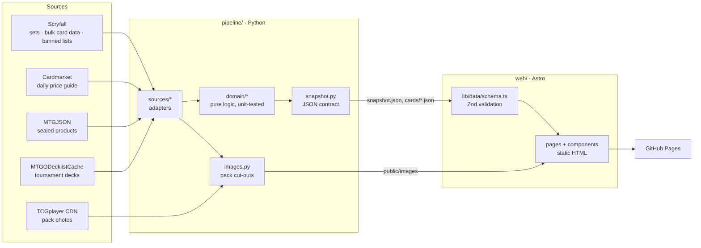

# Deckade

**Which Magic: The Gathering sets are in Standard right now – and when do they rotate out?**

Deckade is a bilingual (German / English) website that answers that question with
nothing but public data: every Magic set since 1993 on one timeline, marked where Standard,
Pioneer and Modern begin; the Standard rotation in detail; every card with its Cardmarket
price and how often it is played in tournaments; bundle and booster box prices. The data
refreshes daily.

The project consists of two parts with a clear contract between them:

| Part                    | Stack                                                    | Responsibility                                                    |
| ----------------------- | -------------------------------------------------------- | ----------------------------------------------------------------- |
| [`pipeline/`](pipeline) | Python 3.12, httpx, Pillow · pytest, mypy (strict), ruff | Fetch the sources, apply the rotation rule, write a JSON snapshot |
| [`web/`](web)           | Astro 7, TypeScript (strict), Zod · Vitest, Prettier     | Validate the snapshot and render a static, SEO-friendly website   |

## Features

- **Set overview** – every set newest first, grouped by year. Faded marker lines show the key
  points: which sets rotate out next, where Standard, Pioneer and Modern begin. Sets that do not
  follow their era (e.g. Modern Horizons, reprint sets) carry a small format badge. Which sets
  are legal where is computed from Scryfall card data, not typed in by hand.
- **Rotation** – the Standard sets grouped into rotation waves, the next rotation as the headline
  ("early 2027 · in about 3 months") and the Standard banned list.
- **Deck import** – reserved tab for the next step.
- **One page per set** – opens as an overlay above the overview (the URL changes, Back closes it,
  a click next to the columns returns); the same page also works on its own for links and search
  engines. Release date, card count, Standard status, a compact strip with every bundle and
  booster box price, and the full card list.
- **Card list** – search, colour filter (cards that fit a deck of the chosen colours), sorting
  by play rate, market value or mana value, and a large preview of the hovered card.
- **Honest about certainty** – see below. Nothing is presented as fact that is only an estimate.
- **German and English**, switchable in the header; every page exists in both languages with
  `hreflang` alternates. A missing translation is a compile error.
- **Fast and indexable** – fully static HTML, no client framework, self-hosted fonts,
  view transitions between overview and set pages. Works without JavaScript; scripts only
  add filtering, sorting and the preview.

## How rotation is determined

The rule is official ([Wizards of the Coast](https://magic.wizards.com/en/formats/standard)):
_once per year, after the first premier set Prerelease of the year, the six oldest sets in
Standard rotate out._ The site only claims what follows from it:

| Statement                  | Basis                                           | Shown as                                  |
| -------------------------- | ----------------------------------------------- | ----------------------------------------- |
| Which six sets rotate next | The rule plus release dates (Scryfall)          | "rotates out early 2027"                  |
| The exact rotation day     | Estimated (Prerelease ≈ release − 7 days)       | Month/year only until set in `rules.toml` |
| When later sets rotate     | Earliest possible date under the current rule   | "stays until at least early 2028"         |
| Foundations                | Mark Rosewater, reported by Wargamer and others | "stays until at least 2029"               |

The logic lives in [`pipeline/src/rotation_radar/domain/rotation.py`](pipeline/src/rotation_radar/domain/rotation.py)
and is covered by unit tests, including the edge case of a special-rule set among the six oldest.
Once Wizards announces the date, set `official_rotation_date` in
[`pipeline/rules.toml`](pipeline/rules.toml) and the site switches to the exact day.

## Architecture



- **Domain logic is pure.** `pipeline/src/rotation_radar/domain` has no network or file access;
  adapters in `sources/` translate raw responses into domain objects.
- **One data contract.** The pipeline writes camelCase JSON (`snapshot.py`, `SCHEMA_VERSION`);
  the website validates it with Zod at build time (`web/src/lib/data/schema.ts`) and fails the
  build instead of shipping a broken page.
- **Wording is logic, too.** `web/src/lib/rotation/describe.ts` turns rotation data into text
  for both languages and is tested with the real dictionaries.

## Project structure

```
pipeline/
  rules.toml                 rotation rule parameters, official date, special rules
  src/rotation_radar/
    domain/                  sets, rotation, cards, products, play rate (pure)
    sources/                 http client, Scryfall (API + bulk file), MTGJSON, Cardmarket, decklists
    images.py                pack cut-outs (white background removal) and mana symbols
    snapshot.py              data contract and JSON writer
    build.py, cli.py         orchestration: python -m rotation_radar build
  tests/
web/
  src/
    config/site.ts           site name, languages
    lib/                     data loading, i18n, formatting, rotation text, sorting
    components/ layouts/ pages/ scripts/ styles/
    data/generated/          snapshot written by the pipeline (not committed)
  public/images/             pack images and mana symbols written by the pipeline (not committed)
  tests/
.github/workflows/           CI and the daily refresh + deploy
```

## Getting started

Requirements: Python 3.12+, Node.js 22.23+ (Astro 7).

```bash
# Data pipeline (about 3 minutes; pack images are cached afterwards)
cd pipeline
python -m venv .venv
.venv/Scripts/activate          # Windows; on macOS/Linux: source .venv/bin/activate
pip install -e ".[dev]"
python -m rotation_radar build  # writes web/src/data/generated and web/public/images

# Website
cd ../web
npm ci
npm run dev                     # http://localhost:4321
```

The website needs a snapshot: run the pipeline once before `npm run dev` (about a minute;
the Scryfall bulk file and pack images are cached in `pipeline/.cache` and `web/public/images`).
Generated data is not committed – CI and the deployment build it fresh.
Set `GITHUB_TOKEN` to raise the GitHub API rate limit for the decklist download.

## Quality checks

| Pipeline                | Website          |
| ----------------------- | ---------------- |
| `pytest`                | `npm test`       |
| `mypy` (strict)         | `npm run check`  |
| `ruff check src tests`  | `npm run lint`   |
| `ruff format src tests` | `npm run format` |

All of them run in [CI](.github/workflows/ci.yml) on every push and pull request.

## Deployment

[`deploy.yml`](.github/workflows/deploy.yml) runs daily: it rebuilds the snapshot, builds the
site and publishes it to GitHub Pages (enable _Settings → Pages → Source: GitHub Actions_).
`SITE_URL` and `BASE_PATH` configure the public address. The imprint and the privacy notice
name the operator from the repository variables `OPERATOR_NAME`, `OPERATOR_ADDRESS` and
`OPERATOR_EMAIL` (_Settings → Secrets and variables → Actions → Variables_), so personal data
stays out of the code.

## Before going public

Checked on 2026-11-05, 2026-11-06 and 2026-11-09 against the sources below. Not legal advice.

| Topic                                                                               | Finding                                                                                                                                                                                                                                                                                                                                                                                                                                                                                                                                                                                                                                                                        | Status                                                                      |
| ----------------------------------------------------------------------------------- | ------------------------------------------------------------------------------------------------------------------------------------------------------------------------------------------------------------------------------------------------------------------------------------------------------------------------------------------------------------------------------------------------------------------------------------------------------------------------------------------------------------------------------------------------------------------------------------------------------------------------------------------------------------------------------ | --------------------------------------------------------------------------- |
| [Wizards Fan Content Policy](https://company.wizards.com/en/legal/fancontentpolicy) | Footer notice matches the required wording; content must stay free (ads, sponsors and donations are allowed if access is not restricted); no Wizards logos or trademarks in the site's own branding.                                                                                                                                                                                                                                                                                                                                                                                                                                                                           | ✅ met                                                                      |
| [Scryfall API](https://scryfall.com/docs/api)                                       | Free for community content, no paywall; images must not be cropped (artist and copyright line), distorted, recoloured or watermarked; use the image URLs from the API; send User-Agent and Accept headers.                                                                                                                                                                                                                                                                                                                                                                                                                                                                     | ✅ met as far as checked                                                    |
| [Scryfall image guidelines](https://scryfall.com/docs/api/images)                   | No blurring, sharpening, desaturating or colour shifting; art crops need the artist named in the same interface. The background shows the art crops unchanged (dark layers on top only) and the footer names every artist. The live page blocks automated access; the rules were read from copies of the docs.                                                                                                                                                                                                                                                                                                                                                                 | ✅ met; re-read the live page once by hand                                  |
| Site name "Deckade"                                                                 | No Wizards trademark in the name (the earlier "Magic-O" contained "Magic"). A web search on 2026-11-09 found no Magic product or trademark called "Deckade", only an itch.io comment naming a game of that name and a card game prototype "Deckayde". The trademark registers (DPMA, EUIPO, USPTO) were not searched.                                                                                                                                                                                                                                                                                                                                                          | ✅ most likely fine; registers not searched                                 |
| Cardmarket price guide                                                              | The files were [opened to all users](https://news.cardmarket.com/en/Magic/were-making-the-price-guide-and-product-catalogue-available-for-download), but no explicit terms for republishing them were found.                                                                                                                                                                                                                                                                                                                                                                                                                                                                   | ⚠️ ask Cardmarket in writing                                                |
| Pack photos (TCGplayer CDN)                                                         | The [TCGplayer Terms of Service](https://help.tcgplayer.com/hc/en-us/articles/205004918) do not allow using their material outside TCGplayer without written permission.                                                                                                                                                                                                                                                                                                                                                                                                                                                                                                       | ❌ replace (e.g. set symbols or official Wizards images) or get permission  |
| Impressum (§ 5 DDG, § 18 MStV)                                                      | § 5 DDG covers services offered "geschäftsmäßig"; a non-commercial fan site without ads is most likely exempt. § 18 (1) MStV, however, asks every site that does not serve purely personal or family purposes for name and address, and that exemption is read narrowly ([NLM guide](https://www.nlm.de/fileadmin/dateien/pdf/leitfaden_impressumspflicht_2024.pdf), [Medienanstalt NRW](https://www.medienanstalt-nrw.de/fileadmin/user_upload/lfm-nrw/Regulierung/Beschwerde/Infos_kompakt/Infos_kompakt-Impressumspflicht.pdf)). A public fan site most likely needs name and a postal address where legal documents can be served (no P.O. box). Page: `/[lang]/imprint/`. | ⚠️ set `OPERATOR_ADDRESS`; get advice if unsure                             |
| Privacy notice (DSGVO)                                                              | Hosting logs (GitHub logs every visitor IP; GitHub is certified under the EU-U.S. Data Privacy Framework) and images loaded from Scryfall process IP addresses. No cookies, no tracking, no browser storage, fonts self-hosted. Page: `/[lang]/privacy/`. Whether Scryfall is covered by the DPF is unknown.                                                                                                                                                                                                                                                                                                                                                                   | ✅ page added; set `OPERATOR_NAME`, `OPERATOR_ADDRESS` and `OPERATOR_EMAIL` |
| Licences                                                                            | MTGJSON, MTGODecklistCache and this repository.                                                                                                                                                                                                                                                                                                                                                                                                                                                                                                                                                                                                                                | ⚠️ open                                                                     |

## Roadmap

- User accounts with a personal collection and decks (server rendering in Astro + an API
  built on the existing Python domain layer).
- Card scanning in the browser (camera via `getUserMedia`, recognition by name or image).
- Price history and play-rate trends around a rotation.
- More expressive visuals.

## Legal

Deckade is unofficial Fan Content permitted under the Fan Content Policy. Not
approved/endorsed by Wizards. Portions of the materials used are property of Wizards of the
Coast. ©Wizards of the Coast LLC.
