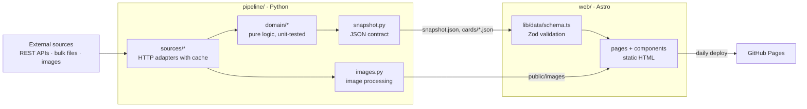

# Deckade

**Which Magic: The Gathering sets are in Standard right now – and when do they rotate out?**

Deckade is a bilingual (English / German) fan website that answers that question with nothing
but public data:

- every Magic set since 1993 on one timeline
- the Standard rotation in detail
- every card with an estimated price and how often it is played in tournaments
- what bundles and booster boxes contain

## Features

- **All sets** – a timeline by year. Each set opens as an overlay with its own URL: release
  date, card count, its products and the full card list. On phones each year's packs form a
  fan to swipe through.
- **All cards** – every card once (cheapest printing, newest image), with search in name and
  rules text, filters for colour, mana value and type, and a large card preview.
- **Standard rotation** – the Standard sets grouped by when they leave, the next rotation as
  the headline. Estimates are labelled as estimates.
- **Search** – a request in plain English or German ("cheap red creatures with haste") becomes
  filters for colour, type, keyword, synergy ("synergy with artifacts"), mana value, price
  and order. It runs in the browser
  ([ADR 0002](docs/adr/0002-natural-language-search.md)).
- **German and English** – every page in both languages; German pages show German card names
  and images wherever a German printing exists.
- **Static and fast** – plain HTML without a client framework and self-hosted fonts; JavaScript
  only adds filtering, sorting and the set overlay.

## Technical implementation

The project consists of two parts with a clear contract between them:

| Part                    | Stack                                                    | Responsibility                                                   |
| ----------------------- | -------------------------------------------------------- | ---------------------------------------------------------------- |
| [`pipeline/`](pipeline) | Python 3.12, httpx, Pillow · pytest, mypy (strict), ruff | Fetch and process the data, write a JSON snapshot and the images |
| [`web/`](web)           | Astro 7, TypeScript (strict), Zod · Vitest, Prettier     | Validate the snapshot and render a static, SEO-friendly website  |

### Architecture



- **Everything happens at build time.** The pipeline collects and processes the data once per
  build; the deployed site is plain static files, without a server or a database.
- **Domain logic is pure.** `pipeline/src/rotation_radar/domain` has no network or file access;
  adapters in `sources/` translate raw responses into domain objects.
- **One data contract.** The pipeline writes camelCase JSON (`snapshot.py`, `SCHEMA_VERSION`);
  the website validates it with Zod at build time (`web/src/lib/data/schema.ts`) and fails the
  build instead of shipping a broken page.
- **Wording is logic, too.** `web/src/lib/rotation/describe.ts` turns rotation data into text
  for both languages and is tested with the real dictionaries.

### Project structure

```
pipeline/
  rules.toml                 rotation rule parameters, official date, special rules
  src/rotation_radar/
    domain/                  sets, rotation, cards, products, play rate (pure)
    sources/                 HTTP client and one adapter per external source
    images.py                image processing: pack images and mana symbols
    snapshot.py              data contract and JSON writer
    build.py, cli.py         orchestration: python -m rotation_radar build
  tests/
web/
  src/
    config/site.ts           site name, languages
    lib/                     data loading, i18n, formatting, rotation text, sorting
    components/ layouts/ pages/ scripts/ styles/
    data/generated/          snapshot written by the pipeline (not committed)
  public/images/             images written by the pipeline (not committed)
  tests/                     incl. contract/: snapshot files the pipeline tests keep current
docs/adr/                    architecture decisions
.github/workflows/           CI for main and pull requests, daily refresh + deploy
```

## Getting started

Requirements: Python 3.12+, Node.js 22.23+ (Astro 7).

```bash
# Data pipeline
cd pipeline
python -m venv .venv
.venv/Scripts/activate          # Windows; on macOS/Linux: source .venv/bin/activate
pip install -e ".[dev]"
python -m rotation_radar build  # writes web/src/data/generated and web/public/images

# Website
cd ../web
npm ci
npm run dev                     # http://localhost:4321
```

The website needs a snapshot: run the pipeline once before `npm run dev`. The first run
downloads about 480 MB of Scryfall bulk data and the pack images and takes several minutes;
both are cached in `pipeline/.cache` and `web/public/images`, so later runs take about two.
Generated data is not committed: the deployment builds it fresh every day.
Set `GITHUB_TOKEN` to raise the GitHub API rate limit for the decklist download.

## Quality checks

| Pipeline                | Website          |
| ----------------------- | ---------------- |
| `pytest`                | `npm test`       |
| `mypy` (strict)         | `npm run check`  |
| `ruff check src tests`  | `npm run lint`   |
| `ruff format src tests` | `npm run format` |

All of them run in [CI](.github/workflows/ci.yml) on every push to `main` and on every pull
request. CI does not download live data: the website is checked against the small snapshot in
`web/tests/contract`, which the pipeline's contract test keeps in sync with what the pipeline
writes. After an intended change of the data contract, run
`UPDATE_CONTRACT=1 pytest tests/test_contract.py` and check the diff.

CI also runs [Lighthouse](web/lighthouserc.json) on the built overview, cards, rotation and
search pages. Accessibility, best practices and SEO must reach their minimum scores;
performance below 0.8 only warns, as shared runners are not steady enough for a hard limit.
The reports are attached to each run as the `lighthouse` artifact. Locally, after
`npm run build` in `web/`: `npx @lhci/cli@0.15.1 autorun` (set `CHROME_PATH` if Chrome is not
installed, e.g. to Edge).

## Data sources

- [Scryfall](https://scryfall.com/docs/api): sets, cards, legality, card images and daily euro
  price estimates ([ADR 0003](docs/adr/0003-scryfall-prices.md)).
- [MTGODecklistCache](https://github.com/Jiliac/MTGODecklistCache): tournament decklists, from
  which the play rates are computed.
- [MTGJSON](https://mtgjson.com): what sealed products contain.
- [Wizards Play Network](https://wpn.wizards.com/en/products): official booster images
  ([ADR 0001](docs/adr/0001-pack-image-sources.md)).

Sealed products link to Cardmarket for prices; Cardmarket's own data is not used.
Deployment and the legal checks are in the [maintainer notes](docs/maintainer-notes.md).

## Roadmap

- Semantic search beyond the rules: similar cards from embeddings computed in the pipeline;
  a server with a local language model (the C#/.NET start in `api/`) only if that is not enough.
- User accounts with a personal collection and decks.
- Card scanning in the browser (camera via `getUserMedia`, recognition by name or image).
- Price history and play-rate trends around a rotation.
- More expressive visuals.

## License

The code is available under the [MIT License](LICENSE). It does not cover the data and images
the site shows: card data and images belong to Scryfall and Wizards of the Coast, pack images
and all Magic: The Gathering material to Wizards of the Coast.

## Legal

Deckade is unofficial Fan Content permitted under the Fan Content Policy. Not
approved/endorsed by Wizards. Portions of the materials used are property of Wizards of the
Coast. ©Wizards of the Coast LLC.
